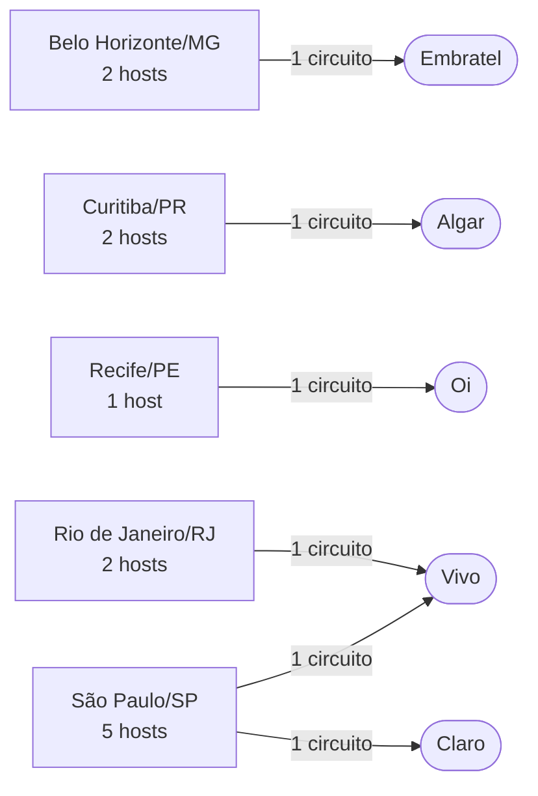
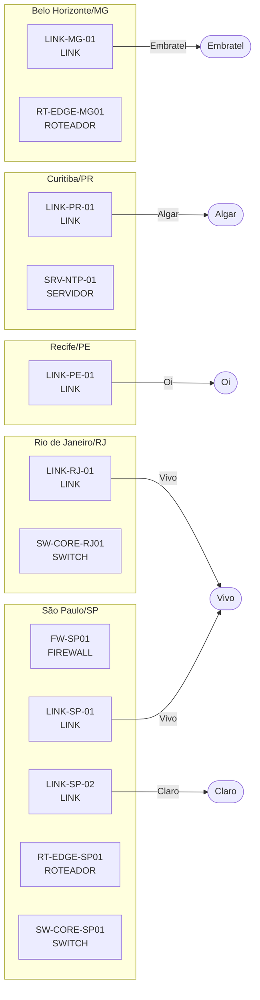

# Topologia de demonstração

Gerado por `python scripts/gerar_demo.py` a partir de `data/inventario-demo-v1.csv`.

## Visão por localidade e operadora



## Visão por host



## Resumo

```text
Inventário: C:\Users\VictorLeitedeAraujo\Downloads\Mapeamento de Redes\data\inventario-demo-v1.csv
Hosts: 12 | Localidades: 5 | Operadoras: 5 | Circuitos (LINK): 6
Tipos: FIREWALL=1, LINK=6, ROTEADOR=2, SERVIDOR=1, SWITCH=2

Dependência por localidade:
  Belo Horizonte: Embratel (1)
  Curitiba: Algar (1)
  Recife: Oi (1)
  Rio de Janeiro: Vivo (1)
  São Paulo: Claro (1), Vivo (1)

Atenção: 4 localidade(s) dependem de uma única operadora: Belo Horizonte, Curitiba, Recife, Rio de Janeiro

Nenhum problema de validação encontrado.
```
